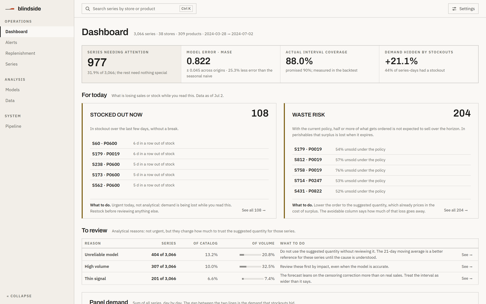
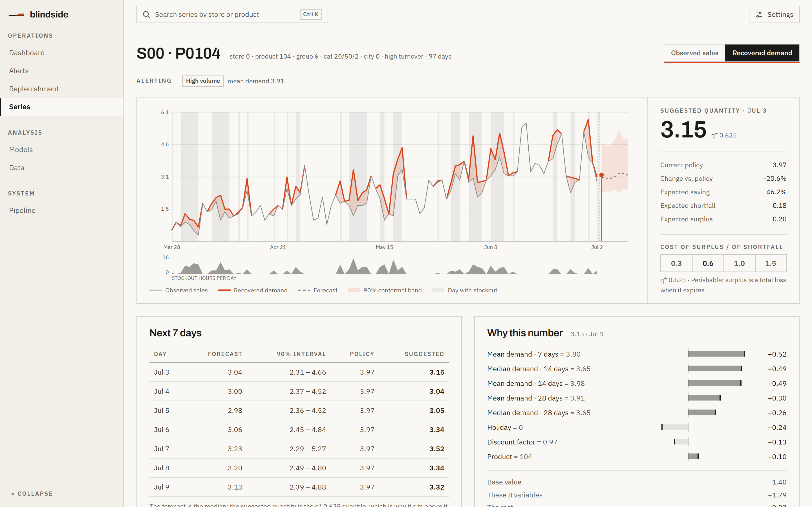
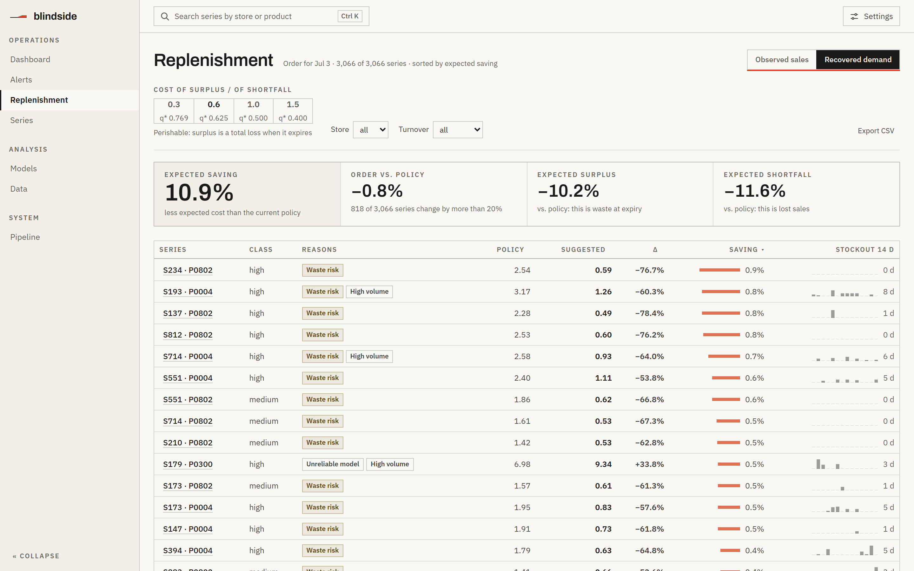
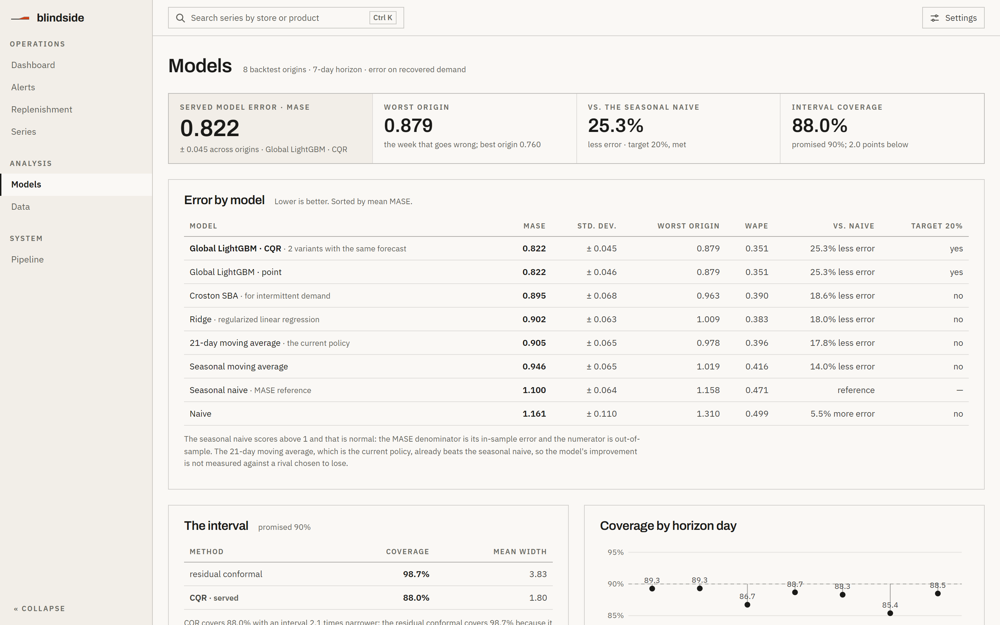

# Blindside


Demand forecasting for perishable products by store and product, with **recovery of demand
censored by stockouts** and a **decision layer** that turns the forecast into a concrete
reorder quantity.

> Stockouts hit you on the blind side: sales drop to zero and your ERP never records that there
> was demand. **Blindside recovers that demand before forecasting.**

Capstone project · Applied Machine Learning & Deep Learning Diploma · FIUNA 2026.

*Read this in [Spanish / Español](README.es.md).* The supporting documents under `docs/` are in
Spanish.

---

## The problem

In perishable retail, replenishment is decided with manual rules based on the average of the last
few weeks. That produces **stockouts** of fast movers and **spoilage** of lots that did not sell,
both at once: the two errors coexist because nobody estimates the uncertainty, and overstock works
as expensive, blind insurance.

There is an earlier problem that most pipelines ignore: when there was a stockout, recorded sales
are zero but real demand was not. Training on observed sales produces the **spiral-down effect**:
you order too little, stockouts increase, you observe less demand, and you order even less. This
project fixes that first and forecasts second.

## What it delivers

It does not stop at a prediction. It ends in an **order quantity**, derived from the economics of
the business: with `Cu` the cost of falling short and `Co` the cost of ordering too much (which for
perishables is a total loss at expiry, not tied-up capital), the optimal replenishment quantile is
the critical fractile `q* = Cu / (Cu + Co)`. The model is trained with quantile loss at that `q*`,
so its output **is** the order.

## Demo

```bash
make app     # Streamlit dashboard, 8 screens
make api     # FastAPI on localhost:8000, /docs for the OpenAPI
make front   # React frontend on localhost:5173 (needs the API running)
```

> **The API has no authentication.** That is deliberate for the prototype's scope (it binds to
> `127.0.0.1` and runs behind Docker Compose), but it is better said than left implicit: anyone who
> can reach the port can query every forecast and every reorder quantity, which is commercially
> sensitive information. There is no rate limiting either, and a `/forecast` over 500 series is an
> expensive query. **Do not expose it to a public network without adding authentication first.**
> For the multi-tenant Phase 2 this is a blocker: it needs per-tenant authentication and data
> isolation.

<picture>
  <source media="(prefers-color-scheme: dark)" srcset="docs/assets/screens/dashboard-dark.png">
  
</picture>

**Defense:** [slides as PDF](docs/slides/blindside_defensa.pdf) ·
[Marp source](docs/slides/blindside_defensa.md) ·
[demo script](docs/demo_guion.md), all in Spanish.

> There is no public deployment: the API has no authentication and exposing it beyond `127.0.0.1`
> would be unsafe. For the defense it runs locally with Docker Compose.

## Frontend

React + Vite + TypeScript in `frontend/`, seven screens in three groups. The visual direction comes
from `docs/design_handoff_dfcore/`; the screen architecture and the rule for where each piece of
data lives, from [`docs/rediseno_frontend.md`](docs/rediseno_frontend.md); the data, from the API.

| Group | Screen | Answers |
|---|---|---|
| Operations | **Dashboard** | What is happening today and where to start. It is the entry point |
| Operations | **Alerts** | Which series to look at and for what reason |
| Operations | **Replenishment** | How much to order for each series, sorted by savings across **the whole catalog** |
| Operations | **Series** | Why to trust that quantity: chart, next 7 days, the per-feature explanation and the series' censoring |
| Analysis | **Models** | How good the model is and where it fails, with the CQR interval against residual conformal |
| Analysis | **Data** | What the panel looks like and how much demand the stockouts hide, with the catalog map |
| System | **Pipeline** | Which data and which model are being served, and how they get updated |

<picture>
  <source media="(prefers-color-scheme: dark)" srcset="docs/assets/screens/series-dark.png">
  
</picture>

*Series: observed sales against recovered demand, the stockout days, the forecast with its 90%
conformal band, and why the model suggests that quantity.*

Each piece of data has an owner screen and the others link to it: MASE lives in Models, freshness
in Pipeline, panel censoring in Data. Controls live where they act: the censoring toggle and the
cost ratio appear in Replenishment and Series, and the store and class filters in Replenishment
and Alerts. Each screen's technical detail is folded under "How it's calculated".

The interface opens in **English**; Spanish and the theme (system, light or dark) are chosen in
**Settings**, top right, and saved in the browser. `?lang=es` in the link opens straight into
Spanish. The strings live in `frontend/src/i18n/`, typed: a key missing in one language does not
compile.

Alerts are **by reason, not by score**: stocked out now, waste risk, unreliable model, high volume
and thin signal. They flag 977 of 3,066 series, and each one comes with what it means, what to do,
its threshold and the figure that triggered it on each series.

**Waste risk is not "about to expire".** FreshRetailNet-50K has no shelf life, lot or on-hand
stock, so an expiry alert would have to make those numbers up. What is measured is the **expected
leftover of the current policy** over expected 7-day demand, integrated under the model's
predictive distribution. For perishables, that leftover is what expires on the shelf. The alert
requires it to reach 50% and the suggested quantity to reduce it: it flags 204 series (6.7%).

```bash
make front-setup    # npm install
make front          # dev server at http://127.0.0.1:5173
make front-test     # vitest: pure logic + rendering with mocked fetch
make api-schema     # regenerates the TS types from the OpenAPI
```

**Types are not written by hand**: `frontend/src/api/schema.d.ts` is generated from the OpenAPI that
FastAPI produces, so a rename in `api/schemas.py` breaks the frontend build instead of breaking the
demo.

**The frontend calls the API over HTTP, not through a Vite proxy.** A proxy would make the calls
same-origin and hide a misconfigured CORS until deployment. That is why the API publishes an
explicit allowlist of origins (`BLINDSIDE_CORS_ORIGINS`, by default Vite's ports 5173 and 4173)
and not a wildcard: without authentication, `allow_origins=["*"]` would mean that any page open in
the user's browser could read every store's forecasts.

<picture>
  <source media="(prefers-color-scheme: dark)" srcset="docs/assets/screens/replenishment-dark.png">
  
</picture>

*Replenishment: the suggested order for the whole catalog, sorted by expected saving, with the
censoring toggle at the top right.*

The central control is the **censoring toggle**, and it changes the decision, not just the chart:
there are **two artifacts**, one trained on observed sales and one on latent demand, with the same
architecture and the same hyperparameters so that the comparison is paired. Measured on 25 series
with `q* = 0.625`:

| Basis | Forecast | Order quantity | Current policy | Δ expected cost |
|---|---|---|---|---|
| Observed sales | 190.229 | 210.958 | 231.960 | −14.09% |
| Recovered demand | 238.413 | **268.478** | 278.596 | −8.64% |

Correcting the censoring raises the forecast **+25.3%** and the order **+27.3%**. With a single
artifact the toggle would have moved the chart and not the quantity, which is half of the
project's argument.

All four columns come from the API and none is written by hand: the forecast is the sum of
`/forecast`, and the order, the policy and the delta come from `/reorder` (`qty`, `policy_qty` and
`total_cost_delta_pct`). The policy is the 21-day moving average **of the same basis**, because
comparing it against observed sales while the model forecasts latent demand would hand the model
exactly the difference that the table measures separately.

**The cost delta does not need to know what demand actually happened.** Both quantities, the
model's and the policy's, are evaluated under the **same** predictive distribution, so what changes
is the decision and not the assumption. Expected shortage and leftover come from integrating
`E[(D−q)⁺]` over the inverse CDF that the quantiles describe; they are expectations implied by the
model, not measured outcomes, and the shortage is a **lower bound** because the grid ends at the
0.95 quantile and the top 5% of the mass is not described. The response returns that `tail_mass`
so the interface can say so.

No figure in the interface is computed on the client. What used to live in
`frontend/src/domain.ts` (the moving-average policy, the per-row impact with the band taken as
uniform, the table ordering) is now served by the API; that file was left with presentation logic
and its test.

### The commercial plan for the horizon is declared

The model uses three covariates of the target day that are not leakage because they are known in
advance: discount, holiday and commercial activity. In the backtest they come from the panel, which
already has those days. In production the horizon is **after** the last day of the panel, so there
is nowhere to read them from: either the caller provides them, since they know their commercial
plan, or they have to be assumed.

All three endpoints accept an optional `plan`, and when it is missing the server assumes the median
of the last 21 days of the panel and **declares it in the response**:

```json
"plan": {"plan": {"discount": 0.967, "holiday_flag": 0, "activity_flag": 0},
         "source": "panel_median", "window_days": 21}
```

That default was chosen by measurement, not by taste; the five variants evaluated are in
`docs/decisiones.md` D19. Before this, the three covariates arrived as **NaN**, and the measured
cost of that was large: see the leakage section.

## Notebooks

Six, executed and with their outputs committed, in `notebooks/`. They are read in order and each
one closes with what its findings mean for the rest of the project.

| Notebook | What it answers |
|---|---|
| `01_eda` | What is in the panel, how demand is distributed, how much censoring there is, and the **verification** that the 16-slot commercial window reproduces the ≈20% stated in the dataset card |
| `02_features_validacion` | The eight leakage asserts running, **each one with its leak injected** to prove it catches it |
| `03_modelos_backtest` | The rolling-origin backtest, MASE with dispersion across origins, and why seasonal naive scores 1.10 and not 1.00 |
| `04_no_supervisado` | PCA of the catalog, with the explained variance alongside. And the two declared M4 gaps |
| `05_decision_conformal` | The expected-cost optimum landing at `q*`, and CQR against residual conformal |
| `06_roi` | Savings as a percentage, against four policies, without converting to currency |

```bash
make notebooks        # runs all six in order, in place
```

**The directory rule: notebooks import from `src/blindside` and contain no logic.** If a
calculation lives in a cell, it has no test and never reaches production; when one is needed, it
goes into the package and the notebook calls it. That is why the cells are short.

They run on a **declared subsample of 400 series** with the project seed, except `01` and `04`,
which use the full panel. The official numbers come from `make models` over the 3,066 series with
8 origins; the notebooks show the mechanism and state their scope. When the official report exists
in `reports/`, `03` loads it and compares the two runs.

Two things that came up **while writing them**, and that stayed in:

- The target alignment test passes with LightGBM and narrowly fails with Ridge. It is not a
  misalignment (the pipeline is the same); shifting the target backwards brings the task closer to
  pure autoregression, which for a linear model is *easier*. The lesson is that the sensitivity of
  that test depends on the model it runs with.
- In the policy comparison, fixed safety stock **beats the model** by 6 points. It uses each
  series' true quantile, which is oracle knowledge, so it is neither implementable nor an upper
  bound; but it bounds how much of the savings can be attributed to the daily forecast rather than
  to having picked the right quantile.

## Results

Measured on **3,066** store-product series (38 stores, 97 days), rolling-origin backtesting with
**8 origins**, a **7-day** horizon, and recovered latent demand as the target. 1,545,264
predictions evaluated. Full report in `reports/metrics.md`, generated by `make models`.

| Model | MASE | Std. across origins | Worst origin | Δ vs seasonal naive |
|---|---|---|---|---|
| **CQR on quantile LightGBM** · the served artifact | **0.8217** | 0.0454 | 0.8790 | **+25.3%** |
| Residual conformal on the same base | 0.8217 | 0.0454 | 0.8790 | +25.3% |
| Global LightGBM (point) | 0.8222 | 0.0457 | 0.8791 | +25.3% |
| Croston SBA | 0.8952 | 0.0683 | 0.9631 | +18.6% |
| Ridge | 0.9018 | 0.0626 | 1.0088 | +18.0% |
| 21-day moving average | 0.9048 | 0.0654 | 0.9779 | +17.8% |
| Seasonal moving average | 0.9460 | 0.0655 | 1.0189 | +14.0% |
| Seasonal naive | 1.1002 | 0.0636 | 1.1579 | — |
| Naive | 1.1606 | 0.1099 | 1.3105 | −5.5% |

The SMART goal was to **reduce MASE by at least 20%** against seasonal naive. It is met with 25.3%,
and the **worst** of the eight origins stays below 0.88, so the result does not rely on averaging a
good origin with a bad one.

The first two rows have the same MASE to the fourth decimal, and that is correct: they are the same
base model with two different conformal wrappers, and **neither touches the point prediction**.
What changes between them is the interval, and there the difference is large.

Every metric comes **with its dispersion across origins**, never as a single number: a good average
can hide a catastrophic origin, and the catastrophic origin is the one that happens in production.

<picture>
  <source media="(prefers-color-scheme: dark)" srcset="docs/assets/screens/models-dark.png">
  
</picture>

*Models: the same table, served by the API, next to the interval comparison and the coverage by
horizon day.*

### Interval coverage, the second success metric

| Model | Nominal | Empirical | Gap | Mean width | Width std. |
|---|---|---|---|---|---|
| **CQR** | 90% | **88.0%** | **−2.0 pts** | **1.805** | 0.153 |
| Residual conformal, adaptive | 90% | 98.7% | +8.7 pts | 3.834 | 0.526 |

Absolute-residual conformal covers almost nine points **above** what it promises, and that is not
prudence: it pays for it with an interval twice as wide. The degenerate case of that logic is
`[0, ∞)`, which covers 100% and says nothing.

CQR lands two points below nominal with an interval **53% narrower**. Two points of under-coverage
is a real deviation and worth stating: the split-conformal guarantee assumes exchangeability, and in
a time series with a temporal split that only holds approximately. The alternative was to keep
covering 98.7% with a useless band.

**Why the other one could not be fixed by tuning a parameter.** Its conformity score is an
**absolute** residual, so the quantile always comes out positive and the mechanism only knows how
to widen. CQR's score is `max(q_lo − y, y − q_hi)`, which is negative when the point fell inside the
interval, so the correction can **tighten**. Details and measurement in `docs/decisiones.md` D21.

### The contrast against per-series classical models

The model the project defends is **global**: a single LightGBM that sees all 3,066 series at once.
The obvious objection is that time-series forecasting has a tradition of **per-series** models, and
that a global model could be winning only because it was compared against simple baselines. SARIMA
and Prophet are the answer.

Measured on a declared subsample of **400 series** with the same 8 origins, because they are
per-series and cost ~650 ms and ~300 ms each, so all 3,066 would take hours. Report in
`reports/metrics_classical.md`, generated by `make classical`:

| Model | MASE | Std. | Worst origin | Δ vs seasonal naive |
|---|---|---|---|---|
| **Global LightGBM** | **0.8386** | 0.0549 | 0.9029 | **+24.2%** |
| Croston SBA | 0.9032 | 0.0707 | 0.9873 | +18.3% |
| SARIMA `(1,0,1)(1,0,0)[7]` | 0.9136 | 0.0599 | 0.9832 | +17.4% |
| 21-day moving average | 0.9139 | 0.0652 | 0.9927 | +17.4% |
| Prophet | 0.9698 | 0.0704 | 1.0502 | +12.3% |
| Seasonal naive | 1.1058 | 0.0674 | 1.1761 | — |

> The Prophet row requires the optional install; without it `make classical` still runs and the
> report comes out with the other five. SARIMA is **not** optional: it comes from `statsforecast`,
> which is already pinned in `requirements.txt`.

The global model beats SARIMA by 8.2% and Prophet by 13.5%. But the most telling figure is a
different one: **SARIMA ties with the 21-day moving average** (0.9136 against 0.9139) and loses to
Croston. The whole ARIMA machinery buys nothing over a simple average on this panel, which is
consistent with short, intermittent series whose weekly seasonality a rolling window already
captures.

Prophet comes last among the fitted models and its worst origin goes above 1.05, which is worse
than the seasonal naive scale. With 97 days there is no annual cycle to estimate, so it is reduced
to trend plus weekly seasonality; the contrast is legitimate, and it is worth saying that this is
not its home turf.

**SARIMA's order is declared, not searched, and that does not handicap it.** `AutoARIMA` costs
2.3 s per series against 85 ms for the fixed order (27 times more), which would make the comparison
impossible within the budget. To rule out that fixing it was a handicap, both were measured on 60
series: the fixed order gives MASE **0.9566** and the search **0.9657**, so the cheap version is
*better*. It can be reproduced with `--models sarima_auto`.

**Prophet is optional and the harness skips it if it is missing.** It is commented out in
`requirements.txt` because it drags in a Stan backend; the import is lazy and
`ProphetForecaster.disponible()` lets the contrast run without it. If you install it, you need both
lines: `pip install prophet==1.1.6 cmdstanpy==1.2.4`. With the cmdstanpy that pip resolves by
default, the Stan bundle ends up without a makefile and Prophet fails with an `AttributeError` that
says nothing about the cause.

### Two notes on how to read the table

**Seasonal naive scores MASE 1.10, not 1.00.** The MASE denominator is its *in-sample* error on
each fold's training set, and the numerator is *out-of-sample*. The second one being larger is
normal, and it is the standard definition.

**The moving-average baselines are tough.** Croston and the 21-day moving average beat seasonal
naive by 18%, so the model's 25.3% is not measured against a rival picked to lose. A project that
only compares against the simple naive hands itself 7 points.

### The hyperparameter search changed nothing, and that gets published too

`make tune` runs Optuna with an objective that is the **same rolling-origin backtest** that produces
the official metrics, not random cross-validation: on panel data a random K-Fold puts later days
into each fold's training set and optimizes against an easier problem than the real one.

25 trials on 400 series and 4 origins. Report in `reports/tuning.md`:

| | MASE | Std. across origins |
|---|---|---|
| Current parameters | 0.8672 | 0.0134 |
| Best found | 0.8630 | 0.0153 |

The improvement is **0.49%** and the dispersion across origins is three times larger, so it is **not
adopted**: that would mistake a lucky draw over the four chosen origins for a real improvement. The
best set also has *more* dispersion than the current one, which is what a search overfitting to the
folds it saw looks like.

The adoption criterion is in the code (`Resultado.vale_la_pena`) and was not decided after seeing
the number, and the report **derives** its conclusion from the numbers instead of carrying fixed
text. `objective` is not in the search space: choosing L1 over L2 is a documented decision, not a
hyperparameter, and leaving it there would let the search change the meaning of the output for a
few thousandths. Details in `docs/decisiones.md` D24.

What is useful about the result is the scale it sets: **the margin left in hyperparameters is
small** compared to other parts of the pipeline. In this same project, fixing the train/serve
mismatch of the horizon covariates was worth 86% of MASE, and separating the booster's quantile from
the conformal band's moved the order by 21%.

### Censored demand recovery

| Group | Observed demand | Latent demand | Uplift |
|---|---|---|---|
| All days | 1.0087 | 1.2218 | +21.1% |
| Days **without** a stockout | 0.9793 | 0.9793 | **0.00%** |
| Days with a stockout | 1.0463 | 1.5318 | +46.4% |

The exactly 0% uplift on clean days is by design, not by chance: those days are the ground truth
the bias is measured against, so correcting them would destroy the measurement.

**Check that the assumed commercial window is the right one:** 43.9% of days with a stockout ×
7.0 average stockout hours / 16 commercial slots = **19.2% of commercial hours in stockout**, which
reproduces the "≈20%" stated in the dataset card. The code also fails if the hours derived from
the hourly mask do not match the `stock_hour6_22_cnt` column, so the assumption is verified on
every run.

See `reports/censoring_ablation.md` for the paired comparison of the same model trained on observed
sales against latent demand, and `docs/decisiones.md` D10 for why it has to be paired. The result,
measured on 99,721 clean days:

| Trained on | Re-censored bias | MASE on clean days |
|---|---|---|
| Observed sales | **−18.19%** | 0.8117 |
| Latent demand | **−6.61%** | 0.8958 |

**11.57 percentage points of bias reduction**, and that is the number the project defends, because
both branches are the same model with the same MASE denominator.

Two things to read carefully in that table, both explained in the report:

- **MASE gets worse in the corrected branch** (0.8958 against 0.8117). It is not a contradiction:
  both are evaluated against observed sales on clean days, and a model that learned to predict
  **latent** demand overpredicts there by construction. It is the price of correcting the bias, and
  the bias is what matters for deciding how much to order.
- **The uncorrected bias on this panel is 2.2 times the one CADRE publishes** (−18.19% against
  −8.1%), so the two figures are not directly comparable and the report no longer pretends they
  are. The most likely cause is the subsampling: 3,066 series chosen by whole store are not the
  dataset's 50,000. What does compare is the **reduction**: 11.57 points here against CADRE's 6.8.

### Clustering and anomalies, with a negative result that gets reported

M4 is implemented: K-Means and DBSCAN on series **shape** features, and Isolation Forest on 14-day
windows. The clusters are interpretable and stable across origins (adjusted Rand index **0.832**
between two origins one week apart), and they read effortlessly: two groups of low-turnover
intermittent series, and one of high turnover with more stockouts, which is consistent because
what sells is what runs out.

**The cluster feature does not go into the served model, and the reason is measured.** A paired
comparison on 600 series and three origins, the same LightGBM with and without the column:

| Origin | Without cluster | With cluster | Delta |
|---|---|---|---|
| 2024-06-11 | 1.5461 | 1.3952 | −9.76% |
| 2024-06-18 | 1.1271 | 1.1215 | −0.49% |
| 2024-06-25 | 1.1123 | 1.2356 | +11.08% |
| **Mean** | 1.2618 | 1.2508 | **+0.28%** |

The mean effect is three tenths of a point and the swing across origins is ±11. The dispersion
crushes the effect, so the honest reading is that there is no measurable signal. **With a single
fold I would have written the opposite**: the first origin I looked at was June 25, where the
feature makes things 11% worse, and the one before says the opposite with almost the same
magnitude.

**And cold start, the declared purpose of that feature, cannot be measured on this panel.** All
3,066 series have exactly 97 days, none has fewer than 21, and none starts selling after day 16.
There is not a single cold-start series: FreshRetailNet delivers complete windows by construction.
The mechanism can be shown, not the benefit, and a feature whose benefit cannot be measured does
not go into the served artifact. Details in `docs/decisiones.md` D23.

**Anomaly detection targets what is not labeled.** Stockouts already come labeled hour by hour, so
estimating them without supervision would replace a label with a worse inference. On 236,082
windows, flagging the rarest 1%: of the 2,361 flagged, **49.9%** were already stockouts, against a
**42.4%** base rate in the panel. Barely seven points above chance on that dimension, so the
detector is **not** a stockout rediscoverer; its contribution is the **1,182** rare windows that no
column flagged.

## Data

**Primary source:** [FreshRetailNet-50K](https://huggingface.co/datasets/Dingdong-Inc/FreshRetailNet-50K)
(Dingdong-Inc, CC BY 4.0): 50,000 store-product series of 90 days, 898 stores, 18 cities, 865
perishable SKUs, with **≈20% stockout events annotated hour by hour**. Paper:
[arXiv 2505.16319](https://arxiv.org/abs/2505.16319).

The dataset is **never loaded in full** (see `docs/decisiones.md`): it is subsampled while reading
the parquet with a fixed seed and the subset is persisted. `data/sample/` holds a small committed
sample so the repo can run without downloading anything.

> **Note on magnitudes.** In the dataset, `sale_amount` and `hours_sale` are multiplied by an
> undisclosed coefficient. Accuracy metrics are valid as they are; ROI is **not** expressed in
> currency from this data. See `docs/roi.md`.

## Docker

Two surfaces orchestrated with Compose, and a separate image for the pipeline.

```bash
make docker-up      # api on :8000, app on :8501
make docker-ps      # status and health
make docker-logs    # logs for both services
make docker-down
```

Data and the artifact are **mounted as volumes**, not copied into the image: `data/` weighs hundreds
of MB and `artifacts/` changes on every training run, so baking them into a layer would make
retraining require a rebuild. To prepare everything without depending on the local environment:

```bash
make docker-data                                            # download + recover censoring
docker compose --profile pipeline run --rm pipeline train    # serialize the artifact
make docker-up
```

### Two images, and why

| Target | Size | Purpose | Includes |
|---|---|---|---|
| `serve` | **1.17 GB** | API + dashboard | numpy, pandas, pyarrow, sklearn, lightgbm, fastapi, streamlit |
| `full` | **3.57 GB** | Pipeline, training, tests | all of `requirements.txt` |

The serving image leaves out torch, jupyter, shap, optuna, umap-learn and xgboost. None of that runs
to answer `/forecast` or to start the dashboard: the served artifact is a LightGBM and the app reads
parquet.

**The image is CPU-only by design, and the build checks it.** On Linux, PyPI's `torch==2.4.1` is the
CUDA build and drags in the `nvidia-*` packages, around 2.5 GB of wheels this project does not use.
The Dockerfile installs `torch==2.4.1+cpu` from PyTorch's CPU index; the `+cpu` variant satisfies
the pin, so there is no version drift. Separately, **xgboost 2.1.1 declares `nvidia-nccl-cu12` as a
hard dependency on Linux** (454 MB measured) for multi-GPU communication that is not used here: it
gets uninstalled, and it is verified that xgboost still trains with `tree_method="hist"`. Between
the two, the pipeline image drops from ~6 GB to 3.57 GB.

There is a build step that **fails** if any `nvidia-*` or `triton` package shows up, so that a
future dependency cannot silently add gigabytes.

The `serve` target does not have its own dependency file either: it installs a short list of
top-level packages with `--constraint requirements.txt`, so the versions come from the **same
file** as the full environment. A separate `requirements-serve.txt` would have been more obvious to
read and would have opened the door to the pins silently drifting apart.

### Verified

```
blindside-api   Up (healthy)   127.0.0.1:8000->8000/tcp
blindside-app   Up (healthy)   127.0.0.1:8501->8501/tcp
```

`/health` responds with the model loaded, `/series` returns the catalog, Streamlit responds at
`/_stcore/health`, and the suite runs inside the container:

```bash
make docker-test    # the full suite in the pipeline image
```

### Deployment security

Ports are published bound to `127.0.0.1`, not `0.0.0.0`. With `- "8000:8000"` Docker would open the
port on every interface of the machine, and **the API has no authentication**: on a shared network
anyone could query the forecasts and the reorder quantities. The containers run as an unprivileged
user (`uid 1000`), and `data/`, `artifacts/` and `reports/` are mounted **read-only** in the query
services; only the `pipeline` profile writes.

Changing the binding to `0.0.0.0` requires adding authentication first.

## Installation

Requires **Python 3.11 or 3.12**. The pins in `requirements.txt` (numpy 2.0.2, torch 2.4.1, numba
via umap-learn) do not publish wheels for 3.13 or 3.14, and unpinning them to make it install would
break the reproducibility that file is protecting.

```bash
git clone https://github.com/FrancoCazal/Blindside.git
cd Blindside

python3.11 -m venv .venv
# Windows
.venv\Scripts\activate
# Linux / macOS
source .venv/bin/activate

make setup          # pinned requirements.txt + the package in editable mode
make test           # the whole suite; no download needed
make test-leakage   # only the leakage tests, the ones from the defense
make app            # dashboard at http://127.0.0.1:8501
```

That already runs: `data/sample/` is committed. To reproduce the results above you need to download
the dataset (115 MB) and regenerate the layers:

```bash
make data       # downloads and subsamples into data/interim/ with a fixed seed
make recover    # recovers censored demand -> data/processed/
make models     # backtest of baselines + LightGBM + Ridge -> reports/metrics.md
make ablation   # censoring ablation -> reports/censoring_ablation.md
```

`make data` and `make recover` take a few minutes. `make models` trains LightGBM and Ridge on eight
folds of 400,000 rows each, so it takes tens of minutes.

## Repository structure

```
Blindside/
├── data/
│   ├── raw/          # original download (not committed)
│   ├── interim/      # subsampled subset (not committed)
│   ├── processed/    # recovered latent demand + features (not committed)
│   └── sample/       # small sample (committed)
├── src/blindside/
│   ├── config.py      # paths, seed, economics, forecasting parameters
│   ├── data/          # schema.py (CONTRACT 1), freshretail.py, loaders.py, update.py (batch ingestion)
│   ├── features/      # calendar.py, lags.py, build.py (anchored at the origin)
│   ├── validation/    # splits.py (rolling origin), leakage.py (the 8 asserts)
│   ├── models/        # base.py (CONTRACT 2), baselines, tabular, gbdt, linear, classical, tuning
│   ├── unsupervised/  # clustering (K-Means/DBSCAN), embeddings (PCA), anomalies (iForest)
│   ├── decision/      # censoring, conformal, newsvendor, policy
│   ├── evaluate/      # contracts.py (CONTRACT 3), metrics, backtest, ablation
│   └── explain/       # attribution.py: local and global TreeSHAP
├── notebooks/         # 6 executed notebooks; they import from src/ and contain no logic
├── tests/             # 320 tests; test_leakage.py holds the 8 checklist items
├── app/               # streamlit_app.py, 8 screens
├── api/               # schemas.py (CONTRACT 4), main.py
├── frontend/          # React + Vite + TS; schema.d.ts generated from the OpenAPI
│   ├── src/api/       # typed client against the contract
│   ├── src/charts/    # hand-written SVG: fixed viewBox and layer order
│   ├── src/i18n/      # typed en/es strings
│   ├── src/screens/   # the 7 screens: Dashboard, Alerts, Replenishment, Series, Models, Data, Pipeline
│   └── src/domain.ts  # presentation logic only; every figure comes from the API
├── docs/              # technical decisions, ROI, project plan (in Spanish)
├── artifacts/         # serialized models (not committed)
└── reports/           # metrics.md, censoring_ablation.md (generated)
```

### The four contracts

They were deliberately frozen before everything else (section 13 of the plan): without them,
parallel workstreams produce pieces that do not fit together.

| Contract | File | What it pins down |
|---|---|---|
| Data schema | `src/blindside/data/schema.py` | Columns, types, granularity, hierarchies |
| Model interface | `src/blindside/models/base.py` | `fit(history)` / `predict(future)`, artifact |
| Backtest result | `src/blindside/evaluate/contracts.py` | Single shape consumed by metrics and dashboard |
| API | `api/schemas.py` | Pydantic request and response |

The second one is what makes the leakage-proof design structural: a model receives `history` (up to
the origin) and a `future` **with no target column**. It has no way to look at the future, not even
by accident. Leakage stops being something you have to remember not to do and becomes something
that cannot be expressed.

## Validation and leakage

The methodology checklist is implemented as **tests that fail if there is leakage**. A README that
says "I avoided leakage" proves nothing.

```bash
make test-leakage
```

| Item | How it is verified |
|---|---|
| No features after `t` | Every feature is constant within each `(series, origin)` |
| Lags per group and sorted | The lag of each series' first row is null |
| No global aggregates | No feature equals a full-panel average |
| No target encoding from the future | No feature correlates ≥ 0.999 with the target |
| Scaler fitted within the fold | Its mean resembles the training set's, not the panel's |
| Shuffle test | With the target permuted, the model does not beat the best constant |
| Target alignment | Shifting the target by one day **worsens** the metric in both directions |
| Fold test | Train and test are disjoint, and the gap equals the horizon |

Each one carries its **negative case**: the leak is injected on purpose and the assert is verified
to catch it. A leakage test that always passes, even with leakage present, is worse than not having
one.

Two of these tests found real leaks and bugs in this code, not hypothetical ones:

- The **target day's** `is_censored` entered the matrix as a feature, because the `merge`
  disambiguated it with the `_target` suffix. That is predicting demand while knowing whether there
  will be a stockout.
- `days_since_start` was anchored to the minimum of each DataFrame, so it ranged 0..18 in training
  and 0..6 at inference. Ridge gave MASE 3.75 with a std. of 5.26; with the fixed anchor it gives
  0.91. LightGBM barely moved, which is what made the bug hard to see.

Details on the second one in `docs/decisiones.md` D12.

### The train/serve mismatch that no metric detected

The leakage asserts cover the **validation** path. There was a third defect that lived only at
**inference**, which is why no backtest saw it: of the 73 features the model receives, the three
covariates known in advance (discount, holiday and activity) arrived as **NaN**.

The mechanism is clean to explain. The frozen origin state drops them on purpose, because they
belong to the target day and have to come from the future index. The backtesting harness fills
them in, because the fold falls inside the panel and those days already exist. The API did not
fill them in, because its horizon starts after the last day of the panel and there is nowhere to
read them from.

Measured on a real fold (training up to 2024-06-25, test from June 26 to July 2, 21,462 rows):

| Horizon covariates | MASE | vs. actual | Order quantity | vs. actual |
|---|---|---|---|---|
| Actual, from the panel | **0.8790** | — | 35,011 | — |
| 21-day median, global · **the default** | 0.9437 | +7.4% | 32,787 | −6.4% |
| 21-day median, per series | 0.9513 | +8.2% | 33,692 | −3.8% |
| List price, no campaign | 0.9571 | +8.9% | 30,390 | −13.2% |
| Carry forward the last known day | 0.9573 | +8.9% | 33,406 | −4.6% |
| **All three as NaN** · what the API was serving | **1.6392** | **+86.5%** | 53,391 | **+52.5%** |

The last row is the one that matters: **1.64 is worse than seasonal naive**, which scores 1.10. The
API was publishing forecasts worse than the baseline the project claims to beat, with orders 52%
higher than they should be, and it answered 200 without a single warning: LightGBM treats NaN as
just another branch, so the output was a plausible number.

Per column, assuming one at a time: `discount` +4.2%, `holiday_flag` +2.6%, `activity_flag` +0.02%.
Discount weighs twice as much as holiday, and the activity flag barely moves the needle.

There is now a test that fails if any of the three arrives null again. The choice of default is in
`docs/decisiones.md` D19.

### A second inference defect, in the decision layer

The served artifact is a conformal wrapper around a quantile LightGBM. Its `predict_quantile`
**discarded the boosters trained with quantile loss** and interpolated between the interval bounds,
so the order quantity came from the shape of the conformal band and not from the `q*` quantile.
Measured on 25 series: the band gave `q0.625 = 1.93` where the trained booster gives 1.52, an order
**21.5% higher**. And since the band is over-inflated, the error always went in the same direction.

It matters because the README claims that "the model is trained with quantile loss at that `q*`, so
its output **is** the order". For the served artifact that was not true. Now, when the base model
can produce quantiles, the base model is in charge; the conformal wrapper still owns the interval,
which is what it has a coverage guarantee for. Details in `docs/decisiones.md` D20.

## Technical decisions and limitations

They are documented in `docs/decisiones.md`, each with what was decided, why, and which
alternative was discarded. The ones worth knowing before reading the results:

1. **7-day horizon, not 4 weeks.** The dataset has 90 + 7 days per series. With a 28-day horizon at
   most 4 backtest origins fit and the methodology declares 8, so the two are incompatible. Also,
   the benchmark's official `eval` split is exactly 7 days, which allows a comparison against the
   published baseline. Details in D8.
2. **Declared subsampling.** 3,066 of the 50,000 series, chosen by whole store with a fixed seed so
   as not to break the hierarchies. The manifest is kept in `data/interim/`.
3. The newsvendor is **single-period**. For perishables with a shelf life longer than the review
   period, the correct model is multi-period perishable inventory with age-based dispatch. The
   approximation holds when the shelf life is close to the review period.
4. **Lead time** and multi-echelon structure are not modeled: what is ordered is assumed to arrive
   for the next period.
5. **Operational order constraints** are not modeled (minimum quantity, case or pallet multiples,
   cold-room capacity). The model emits a continuous number.
6. **The censoring correction is deliberately conservative.** Inflation is capped at ×3, with no
   correction when less than 15% of the daily demand mass remains available. Without those limits,
   a day with 15 of 16 slots out of stock and a single small sale would imply a latent demand
   sixteen times larger, resting on a single data point. A known residual bias is preferred to an
   invented variance, and that keeps the correction below the one published by CADRE. Details in
   D11.

### Framing the differentiator, without inflating it

Combining conformal prediction with the newsvendor **is not an original contribution**. That
calibrated quantile forecasts are equivalent to the optimal newsvendor solution is a published
result ([MDPI JRFM](https://www.mdpi.com/1911-8074/19/3/173)), and conformalizing the critical
quantile has also been done ([Cao 2024](https://arxiv.org/abs/2412.13159)). What is claimed is the
**application**: the implementation running end to end, which is the rare part, because most real
implementations use heuristic safety stock instead of a quantile with verified coverage.

There is also [a published pipeline](https://www.mdpi.com/2411-5134/11/5/89) very similar to this
project, on this same dataset. It is cited on purpose: it is both template and competition, and it
is better to have cited it first.

## Status and next steps

Implemented and verified: contracts, loading and subsampling, censoring recovery, origin-anchored
features, rolling-origin validation with leakage asserts, metrics, backtesting harness, baselines,
LightGBM (point and quantile), XGBoost, regularized regression, **SARIMA and Prophet as a
per-series contrast (M6)**, CQR with verified coverage, newsvendor with expectations derived from
the predictive distribution, policy simulator, **profile clustering and anomaly detection (M4)**,
API, Streamlit dashboard, a 7-screen React frontend with dashboard, alerts and prioritized
replenishment across the whole catalog, an incremental ingestion pipeline with atomic promotion and
rollback, and **local and global TreeSHAP** in `explain/`.

That covers the **minimum defensible scope the plan declares: M2 + M3 + M6**, with M4 on top, its
feature's negative result measured and reported, which is the hardest part to write and the most
valuable one.

Pending from the plan's scope: GRU/LSTM and a temporal transformer (M5), drift (M9), MinT
reconciliation (8.3), and the synthetic generator for the Focal Point case (workstream K).

### Continuous updates: batch ingestion

The system is no longer batch-only. `blindside.data.update` adds new batches to the panel without
redoing the initial load:

```bash
make update-batch                                     # builds a real batch from the eval split
make update INPUT=data/incoming/lote.parquet          # validates, upserts, recovers, writes
make update INPUT=data/incoming/lote.parquet TRAIN=1  # also retrains and promotes
make rollback                                         # goes back to the previous artifact
make update-status
```

- **Input contract:** the original dataset's 19 columns, in parquet or CSV. It is validated with the
  same `build_panel` as the initial load.
- **Upsert by (series, day):** each row is new, an exact duplicate (ignored) or a conflict. A
  conflict **rejects the whole batch** and writes nothing, unless `CONFLICT=replace`.
- **Atomic writes:** each layer is written to a temporary file and moved with `os.replace`. The
  previous version stays as `*.prev.parquet`.
- **Safe retraining:** artifacts are trained as candidates, pass a smoke test and only then get
  promoted. The previous one stays as `*.prev.joblib`.
- **The API reloads on its own** when the files change (every 2 s at most,
  `BLINDSIDE_RELOAD_SECONDS`), and `/health` reports **freshness**: how many days of data the model
  has not seen. It is freshness, not drift.

There is no endpoint that triggers any of this, on purpose: the API has no authentication, and an
unauthenticated route that writes data or changes the served model is a hole. On the real panel,
re-ingesting the eval split gives 21,462 duplicates, 0 new rows and no layer rewritten.

**The limitation that remains on the interval side**, now that CQR is measured: it covers 88.0% when
it promises 90%, two points **below**. The split-conformal guarantee assumes exchangeability and a
temporal split only meets it approximately, so the gap is expected and declared. The order does not
depend on it (it comes from the booster trained at `q*`), but the band drawn in the interface does.

The other limitation runs deeper: the guaranteed coverage is **marginal, not conditional**. The
overall 88% can hide worse subgroups, and the per-horizon breakdown in notebook `05` shows that the
intermediate steps drop to 0.85. Disaggregating is what makes it visible; fixing it would require
conditional or group-wise conformal, and that is on the Roadmap.

Out of scope for the delivery, in `docs/decisiones.md`, Roadmap section. The prioritization of the
final hours, the continuous-update analysis and why FreshRetailNet's days cannot be extended are in
[`docs/auditoria_final.md`](docs/auditoria_final.md).

## License

MIT. See `LICENSE`.

The FreshRetailNet-50K dataset belongs to Dingdong-Inc and is distributed under CC BY 4.0; it is not
redistributed in this repository beyond the sample in `data/sample/`.
